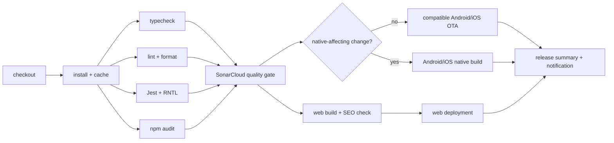

# CI/CD Pipeline — Rusuh Booking Tiket

> **Status:** Locked delivery pipeline for the FE architecture
> **Scope:** Expo + React Native + React Native Web frontend
> **CI:** GitHub Actions
> **Static quality:** SonarCloud
> **Native delivery:** Expo development/preview/production builds through EAS or the approved internal Expo-compatible build service
> **Architecture reference:** `.genesis/docs/ARCHITECTURE.md`
> **FE-BE contract:** `.genesis/docs/FE-BE-align-contract.md`

The repository package manager is **npm** and CI uses the committed `package-lock.json`. If the implementation adopts pnpm or Yarn before delivery, replace the install, cache, and audit commands as one controlled pipeline change; this document does not support mixed lockfiles.

This pipeline is adapted from an internal CI/CD reference pipeline for the ticketing architecture: Android, iOS, web, native capabilities, React Native Web SEO, and OTA promotion through `develop` and `main`.

## 1. Delivery model

```text
feature/*
    │
    ├── pull request → develop
    │                  └── validation gates only
    │
    └── merged into develop → native OTA + web deployment
                              │
                              └── pull request → main
                                                  └── validation + approval
                                                      └── native OTA + web deployment
```

There are two runtime environments:

| Environment | Branch | Android/iOS EAS channel | Web deployment | Backend target | Purpose |
|---|---|---|---|---|---|
| Development | `develop` | `development` | Development web host | Development/mock or integration BE | Team integration and rapid validation |
| Production | `main` | `production` | Production web host/CDN | Production BE | End-user release |

Preview builds are distribution artifacts for QA and product review, not a third runtime environment. They use the development or production-compatible configuration explicitly declared by the build profile.

## 2. Trigger rules

| Git event | Pipeline behavior |
|---|---|
| Pull request opened, synchronized, reopened, or marked ready for review → `develop` | Run typecheck, lint, unit/component tests, security scan, and SonarCloud gates. Stop before web build/deployment, OTA publication, and native distribution. |
| Successful push to `develop` after merge | Run required gates, publish a compatible native OTA update to `development`, and deploy the web artifact to the development host. |
| Pull request opened or synchronized → `main` | Run full release validation. Require approval before merge. |
| Successful push to `main` after merge from `develop` | Run full gates, publish a compatible native OTA update to `production`, and deploy the web artifact to the production host/CDN. |
| `workflow_dispatch` | Allow an authorized operator to rerun validation, publish a selected compatible update, or create a native preview/production build. |
| Native-affecting change | Do not use OTA; route to the Expo native build pipeline. |

An OTA is published only from the target branch after the merge has succeeded. Opening or updating a pull request never deploys user-facing code.

## 3. Job dependency graph

The graph below shows the **post-merge path**. Pull requests run through the gates up to SonarCloud and stop there; they do not publish web or native artifacts.



### Meaning of `native-affecting change?`

This is a release-routing decision, not a separate test. The pipeline checks whether the commit changes anything that is compiled into, configured for, or required by the Android/iOS binary:

- native Android/iOS code or a new/changed native dependency;
- Expo config, config plugins, app identity, URL schemes, entitlements, permissions, icons, or splash assets;
- push-notification, payment, camera, biometric, file-system, WebView, or other native capability configuration;
- Expo SDK or React Native version changes.

If **no**, the compatible JavaScript and assets may be published through Android/iOS EAS OTA, subject to runtime-version compatibility. If **yes**, the pipeline skips OTA for that change and creates new Android/iOS native build artifacts for internal distribution or store release. React Native Web is still exported and deployed separately in both cases.

This protects users from receiving JavaScript that expects native APIs, permissions, or configuration that do not exist in the installed binary.

## 4. Quality and security gates

### 4.1 `typecheck`

- Run TypeScript in strict mode.
- Validate shared packages and the Expo app.
- Fail on unresolved route types, invalid API models, and platform adapter contract mismatches.

### 4.2 `lint`

- Run ESLint for `.ts`, `.tsx`, and configuration files.
- Run Prettier check.
- Reject unused imports, unsafe `any`, accessibility violations configured for React Native, and forbidden direct infrastructure access from UI layers.

### 4.3 `unit_test`

- Run **Jest** with the `jest-expo` preset.
- Run React Native Testing Library component tests.
- Test domain rules, Zustand stores, hooks, use cases, error mapping, timer math, and platform adapter mocks.
- Generate `lcov` coverage for SonarCloud.
- Do not treat snapshots as the primary UI quality mechanism; use behavior assertions and the agreed QA strategy.

### 4.4 Contract validation — outside CI/CD

OpenAPI remains the FE-BE source of truth, but contract validation is not a cloud CI/CD job. FE and BE teams may run it locally or in a separate integration-validation process when an API contract changes. It is intentionally excluded from merge gates and OTA gates.

### 4.5 `vulnerability_scan`

- Run `npm audit --omit=dev --audit-level=high`.
- Run dependency and secret scanning configured by the repository.
- Fail on high/critical production dependency vulnerabilities unless an approved security exception exists.

### 4.6 `sonarcloud`

- Run after typecheck, lint, unit tests, and vulnerability scanning.
- Upload Jest `lcov` coverage.
- Enforce the SonarCloud quality gate for new code:
  - no new blocker/critical bugs;
  - no new security vulnerabilities;
  - no unacceptable new code smells;
  - duplication within the approved threshold;
  - shared domain/application coverage target of **at least 90%** unless explicitly waived.

SonarCloud is a static analysis gate. It does not replace Jest or the agreed QA strategy.

## 5. Web build artifacts

### 5.1 `web_build`

- Run `npx expo export --platform web`.
- Use `web.output: "static"` for build-time prerendered public catalog pages or `"server"` where request-time rendering is required.
- Fail if public SEO routes accidentally use `web.output: "single"`.
- Verify that `/`, representative generated event-detail routes for `/events/[eventId]`, and public event metadata produce indexable HTML. The check validates generated route output, not a literal bracket placeholder URL.
- Verify that `/browse` accepts URL-driven `genre`, `province`, `time`, and `sort` values, handles invalid values safely, and applies the approved canonical/noindex policy for query-result pages.
- Check title, description, canonical URL, Open Graph metadata, JSON-LD, sitemap, and robots output.
- Enforce public and transactional bundle budgets:
  - public route: ≤ 300 KB gzip initial JavaScript;
  - transactional route: ≤ 500 KB gzip initial JavaScript.

This is artifact validation only. Browser-level QA, responsive interaction testing, and accessibility walkthroughs are outside this CI/CD pipeline.

## 6. Native build artifacts

### 6.1 `native_build`

Use Expo development, preview, or production builds to generate native artifacts. Device-level QA is outside this CI/CD pipeline. Expo Go is not a production artifact.

Build targets:

| Target | Artifact | Use |
|---|---|---|
| Android | APK/AAB through Expo build service | Internal distribution or store release |
| iOS | Simulator/device build through Expo build service | Internal distribution or store release |
| Web | Exported web artifact | Web deployment |

## 7. OTA strategy

### 7.1 Development native OTA and web deployment

After a successful merge into `develop`:

1. Confirm the commit is the current `develop` head.
2. Confirm the update contains no native-affecting changes.
3. Run required quality and web gates.
4. Publish Android/iOS JavaScript/assets with the EAS `development` channel when runtime-compatible.
5. Deploy the Expo Web export to the development web host.
6. Record Git SHA, Expo runtime version, environment, native update ID, and web deployment ID.
7. Notify the development testers with the release summary.

### 7.2 Production native OTA and web deployment

After `develop` is merged into `main`:

1. Run the full release pipeline and require approval.
2. Confirm the commit is the current `main` head.
3. Confirm runtime compatibility and no native-affecting changes.
4. Publish Android/iOS JavaScript/assets with the EAS `production` channel when runtime-compatible.
5. Deploy the Expo Web export to the production web host/CDN.
6. Monitor native update adoption, crashes, web health, and critical booking-flow metrics.
7. Roll back the native update or redeploy the previous known-good web artifact if the release causes a material regression.

### 7.3 Web deployment

React Native Web is delivered as web assets through the web hosting/CDN pipeline. It does not receive EAS mobile OTA updates. A web deployment may be rolled back by redeploying the previous successful artifact or reverting the hosting release to its previous version.

Web deployment requirements:

- Deploy only the output that passed the web build, SEO-output, and bundle-size checks.
- Record the Git SHA and deployment ID.
- Keep the previous web artifact available for rollback.
- Invalidate or version CDN assets safely; do not leave HTML pointing to missing assets.
- Verify public route health after deployment.

### 7.4 Native-change routing

Create a new native build instead of OTA when a change includes:

- New or changed native dependency.
- Expo config/plugin change.
- Android/iOS permission or entitlement change.
- Push-notification credentials or configuration.
- App icon, splash, bundle identifier, URL scheme, or associated-domain change.
- Native payment, camera, biometric, file-system, or WebView integration change.

## 8. Build and distribution jobs

### 8.1 `build_android`

- Use Expo/EAS-compatible build configuration.
- Build development, preview, or production profile according to the workflow input.
- Never generate production signing keys inside CI.
- Store Android signing credentials in the approved Expo/EAS credential store or enterprise secret manager.
- Upload the artifact and build metadata.

### 8.2 `build_ios`

- Use Expo/EAS-compatible iOS build configuration.
- Build simulator artifacts when a workflow explicitly requests a local/internal smoke-test artifact; this is an artifact, not an automated CI quality gate.
- Build device/TestFlight artifacts for human QA and distribution.
- Store Apple signing credentials in the approved Expo/EAS credential store or enterprise secret manager.
- Upload the artifact and build metadata.

### 8.3 `distribute_preview`

- Distribute Android and iOS preview builds through the approved internal distribution channel.
- Publish the web preview artifact to the staging web host.
- Include branch, commit SHA, API environment, build profile, and test summary in release notes.

## 9. Required repository scripts

```json
{
  "scripts": {
    "typecheck": "tsc --noEmit",
    "lint": "eslint .",
    "format:check": "prettier --check .",
    "test": "jest --coverage",
    "test:unit": "jest --runInBand",
    "web:build": "expo export --platform web",
    "web:serve": "npx expo serve",
    "ota:development": "eas update --channel development",
    "ota:production": "eas update --channel production"
  }
}
```

## 10. Required secrets and variables

| Secret/variable | Used by | Purpose |
|---|---|---|
| `SONAR_TOKEN` | SonarCloud | Authentication for analysis and quality gate |
| `SONAR_ORGANIZATION` | SonarCloud | SonarCloud organization identifier |
| `SONAR_PROJECT_KEY` | SonarCloud | SonarCloud project identifier |
| `EXPO_TOKEN` | Expo/EAS | CI authentication for builds and OTA |
| `EXPO_PROJECT_ID` | Expo/EAS | Project attribution for builds and updates |
| `EXPO_PUBLIC_API_URL` | App build | Environment-specific API base URL; contains no secret |
| Android signing credentials | Native build | Android release signing, managed securely |
| Apple signing credentials | Native build | iOS build/signing, managed securely |
| Web hosting credentials | Web deployment | Development/production web deployment |

Never store NIK, payment data, API secrets, signing keys, or service-account JSON in the repository or in client-exposed `EXPO_PUBLIC_*` variables.

## 11. Rollback and failure handling

- A failed quality gate blocks merge.
- A failed OTA publication does not change the currently deployed update.
- A bad development OTA is rolled back to the previous development update.
- A bad production OTA is rolled back to the previous production update when runtime-compatible.
- A native regression requires a new build or store/internal-distribution rollback; OTA cannot repair native code.
- Every release records the exact Git SHA, runtime version, channel, update ID, and artifact IDs.
- CI artifacts retain test reports, coverage, SonarCloud links, web export, build logs, and release metadata according to repository retention policy.

### 11.1 OTA rollback procedure

Each OTA release must be associated with a compatible runtime version and retain the previous known-good update group. EAS Update serves the newest compatible update on the channel, so rollback means republishing a known-good update as the newest update rather than deleting the bad history.

#### Emergency production rollback

1. Declare the incident and stop the production promotion pipeline.
2. Protect the `production` channel; only release managers can publish or roll back it.
3. Pause the channel if we need to stop new updates while the incident is assessed:

   ```bash
   eas channel:pause production
   ```

4. Identify the last known-good update group from the EAS deployment history.
5. Republish that compatible update to the production channel, or run the interactive rollback flow:

   ```bash
   eas update:republish --group <known-good-update-group> --destination-channel production
   eas update:rollback <latest-bad-update-group>
   ```

   `eas update:republish` is the preferred explicit recovery path because it promotes a named known-good update to the destination channel. `eas update:rollback <latest-bad-update-group>` rolls back the latest update group on its branch/runtime; use it only with the exact affected group ID. Pin and verify the EAS CLI version used by CI, and run the command with the appropriate platform/runtime controls for the project. Never mix Android/iOS runtimes or publish an incompatible JavaScript bundle.

6. Resume the channel when the rollback is confirmed:

   ```bash
   eas channel:resume production
   ```

7. Verify the rollback with a production-like build, monitor update adoption/crashes, and record the incident, bad update ID, rollback update ID, and Git SHA.

If the previous OTA is not safe, roll back to the update embedded in the installed native build using the EAS rollback-to-embedded flow. If the issue is caused by native code or an incompatible data migration, do not use OTA rollback; release a new native build or fix forward.

#### Development rollback

The same procedure applies to the `development` channel, with a lower approval threshold. Development rollback must still record the update group and verify the current runtime version before republishing.

#### Web rollback

Web rollback is separate from native OTA rollback:

1. Stop the web deployment promotion.
2. Identify the previous successful web artifact and deployment ID.
3. Redeploy that artifact to the affected host/CDN, or use the hosting provider's release rollback.
4. Purge or refresh CDN caches without removing assets still referenced by active HTML.
5. Verify the public routes, metadata, and critical booking entry points.
6. Record the Git SHA, deployment ID, incident, and recovery result.

#### Rollback limitations

- Users who already downloaded a bad update may continue running it until they fetch and launch the rollback update.
- Automatic crash recovery can help with early startup crashes, but it is not the primary incident-control mechanism.
- OTA rollback cannot undo irreversible local-storage or file-system migrations; updates must be backward-compatible or use a fix-forward release.
- A new native build is required when the runtime version, native dependency, permission, or native configuration changes.

## 12. Quality-gate summary

| Gate | Tool | Blocks merge? | Blocks OTA? |
|---|---|---:|---:|
| Type safety | TypeScript | Yes | Yes |
| Code quality | ESLint + Prettier | Yes | Yes |
| Unit/component behavior | Jest + React Native Testing Library | Yes | Yes |
| API compatibility | OpenAPI types and FE-BE review | No | No |
| Dependency security | npm audit + secret scan | Yes | Yes |
| Static analysis | SonarCloud | Yes | Yes |
| SEO output | Expo export validation | Yes for web release | Yes for web release |
| Web bundle budget | Bundle-size check | Yes for web release | Yes for web release |

## 13. Known limitations

- Backend load, inventory correctness, queue fairness, payment settlement, and notification delivery remain BE responsibilities.
- OTA cannot deliver native dependency or permission changes.
- React Native Web uses web deployment rollback, not EAS mobile OTA rollback.
- iOS device testing requires Apple signing and appropriate CI/device access.
- Production web SEO is only valid when the deployed output is static or server-rendered and the public routes have generated HTML.
